<div align="center">

# ⚡ HomePulse

### Your meter sends one number. This decodes the *whole house.*

**One line of total power goes in. A household comes out: which devices exist, when each ran, and what each one costs you.**<br>
No labels. No extra sensors. Hidden Markov models written from scratch in NumPy and scored on **650** days they never saw.


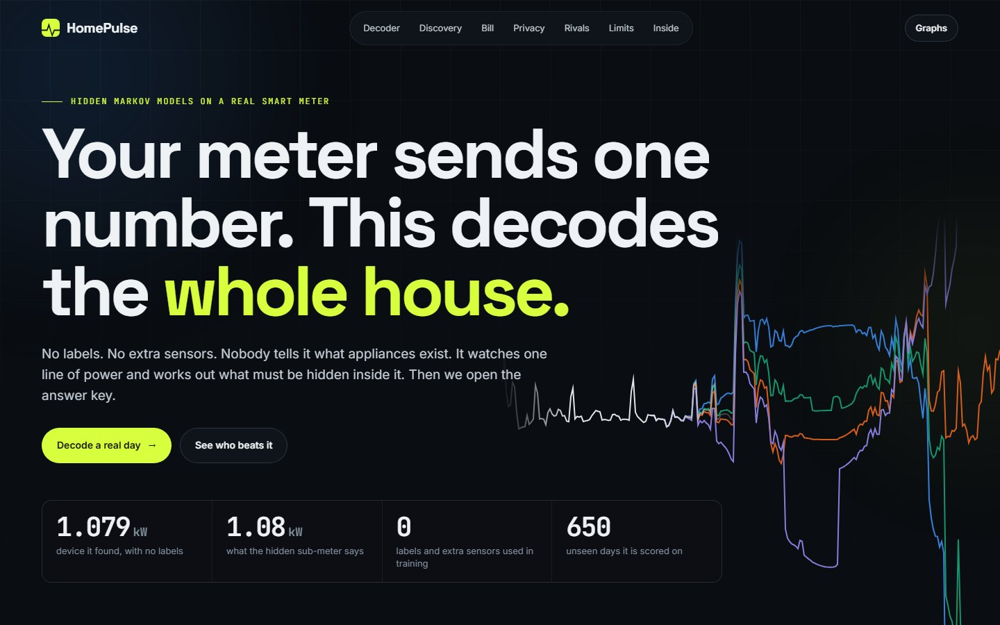

**Live demo:** [https://homepulse-umber.vercel.app](https://homepulse-umber.vercel.app)<br>
[The idea](#idea) · [The discovery](#discovery) · [How it works](#how) · [Models](#models) · [Who wins](#results) · [What failed](#failed) · [Screenshots](#screenshots) · [Run it](#run)

</div>

---

## 📌 At a glance

| 🔎 Device it found alone | 🎯 The real one | 🏷️ Labels used | 📅 Unseen days | 🧮 Models | 📊 Graphs explained |
|:---:|:---:|:---:|:---:|:---:|:---:|
| **1.079 kW** | **1.08 kW** | **0** | **650** | **7** | **50** |

---

<a id="idea"></a>
## 💡 The idea

India had **7.24 crore** smart meters installed by mid-2026, with **20.33 crore** sanctioned
([T&D India, citing Parliament](https://www.tndindia.com/indias-smart-meter-population-at-7-24-crore-parliament/amp/)). Each one reports
a single number: total power. Your bill shows a single total too, so you never see what is actually eating it.

Finding out normally means fitting a separate meter on each appliance. HomePulse asks a different question:

> If a home is just a few on/off devices added together, and we can only see the sum, can we work backwards?

That is a **hidden Markov model** taken literally. The devices are the hidden states, and the meter is the only observation.

Who could use this:

| | Who | What they get |
|:---:|---|---|
| 🏠 | A household | A bill broken down by device, from the meter they already have |
| ⚡ | A utility | Appliance-level insight without installing any extra hardware |
| 🔐 | Anyone thinking about privacy | A concrete demonstration of what meter data reveals |

---

<a id="discovery"></a>
## 🔬 The discovery

The training data contains three sub-meters. **The decoder never sees them.** They stay locked away as an answer key.
After training, we open it:

<div align="center">

| | Learned from the total alone | Real sub-meter |
|---|:---:|:---:|
| **Power of the device** | **1.079 kW** | **1.08 kW** (most common on-power) |
| **Share of all energy** | 34.9% | 39.6% |
| **Total energy, 650 unseen days** | 5,796 kWh | 6,574 kWh (11.8% low) |
| **Month-by-month correlation** | r = 0.91 | |

</div>

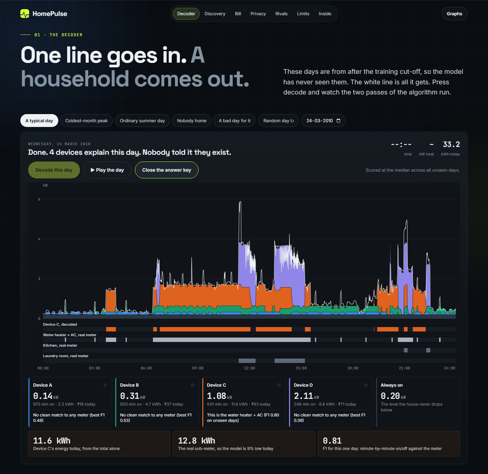

Orange is the device it found. The grey strip below is the real water-heater meter, which it never saw. The violet blocks around noon
also line up with the real laundry meter on this day, but that match does not hold up overall (see [what failed](#failed)). This day
scored at the median of all unseen days, and the app has a button for a bad day too.

---

<a id="how"></a>
## ⚙️ How it works

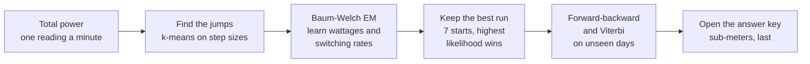

The model is one equation. Each device $m$ is on or off, and the meter reports the sum:

```math
\text{total}(t) = \text{base} + \sum_{m} w_m \, s_m(t) + \varepsilon(t), \qquad s_m(t) \in \{0, 1\}
```

Each device flips by its own two-state Markov chain. Combined, $M$ devices give $2^M$ joint states, and the joint transition matrix is a
Kronecker product, so exact inference stays possible:

```math
A = A_1 \otimes A_2 \otimes \cdots \otimes A_M
```

**Forward-backward** then gives the probability that each device is on at each minute. Everything is kept in range with scaling factors:

```math
\gamma_t(j) \propto \alpha_t(j)\,\beta_t(j), \qquad \log p(x_{1:T}) = \sum_{t} \log c_t
```

The number of devices is not given either. Training tries 1 to 5 chains and stops when the next chain adds under 20% of the previous gain
in held-out likelihood. That rule picks **4**, and answer-key scores play no part in it.

---

<a id="models"></a>
## 🧮 Models

Every model is written from its equations. scikit-learn appears only in the test suite.

| Model | Role | File |
|---|---|---|
| **Markov chain** | Baseline: counts of moves between 12 power levels, $A^k$, stationary distribution | [`markov.py`](backend/markov.py) |
| **Gaussian HMM** | Baum-Welch, scaled and log-domain forward, Viterbi, posterior decoding, prediction | [`hmm.py`](backend/hmm.py) |
| **Factorial HMM** | The decoder: device wattages and switching rates from the total alone | [`fhmm.py`](backend/fhmm.py) |
| **Sum-product** | Message passing on a factor graph. Matches forward-backward to 3e-16 on a real day | [`sum_product.py`](backend/sum_product.py) |
| **Linear dynamical system** | Kalman filter, RTS smoother and EM for the slow trend in daily use | [`kalman.py`](backend/kalman.py) |
| **CART** | Rival: Gini tree on window features, given real sub-meter labels | [`rivals.py`](backend/rivals.py) |
| **AdaBoost** | Rival: 60 shallow trees, also given labels | [`rivals.py`](backend/rivals.py) |

**Data.** The [UCI Individual Household Electric Power Consumption](https://archive.ics.uci.edu/dataset/235/individual+household+electric+power+consumption)
dataset (Hebrail and Berard, CC BY 4.0): 2,075,259 one-minute readings from one house in France, 2006 to 2010, reduced to 1,358 complete days in
[`data/days.npz`](data/days.npz). The split is by time: 200 training days and 60 validation days from before 2009, then all 650 complete days after
it as the test set.

---

<a id="results"></a>
## 🏆 Who wins

The test: **is the water heater + AC on during this minute?** All scores are on the 650 unseen days. The real device changes state 23 times a day.

| Method | Extra hardware? | F1 | Precision | Recall | Changes/day | Energy error |
|---|:---:|:---:|:---:|:---:|:---:|:---:|
| CART, depth 8 | Sub-meter | **0.919** | 0.900 | 0.940 | 39.0 | -3.4% |
| AdaBoost, 60 small trees | Sub-meter | 0.898 | 0.869 | 0.929 | 40.4 | -1.2% |
| Plain HMM, 16 levels + labels | Sub-meter | 0.877 | 0.832 | 0.928 | 16.6 | +3.1% |
| Threshold tuned on labels (1.10 kW) | Sub-meter | 0.874 | 0.819 | 0.936 | 21.7 | +5.6% |
| **Factorial HMM, Viterbi path** | **None** | **0.805** | 0.836 | 0.776 | 16.6 | -11.9% |
| **Factorial HMM, whole day** | **None** | **0.804** | 0.835 | 0.775 | 17.2 | -11.8% |
| **Factorial HMM, live (past only)** | **None** | **0.795** | 0.836 | 0.758 | 28.3 | -14.0% |
| Threshold, 2-means (1.84 kW) | None | 0.482 | 0.817 | 0.342 | 35.3 | -3.1% |
| Threshold, Otsu (1.88 kW) | None | 0.468 | 0.818 | 0.328 | 34.9 | -5.7% |

Three things to read from this:

1. **With labels, trees win.** CART reaches 0.919, and it passes the decoder with only about **3 days** of sub-meter labels. That is the honest price of
   going label-free. But those labels mean fitting hardware, in every home.
2. **With no labels, the decoder is far ahead:** 0.804 against 0.482 for the best threshold. A threshold needs to know the answer to find the right cut-off.
3. **Sequence models do not flicker.** The real device changes state 23 times a day. CART, judging each minute alone, reports 39. The whole-day decoder reports 17.

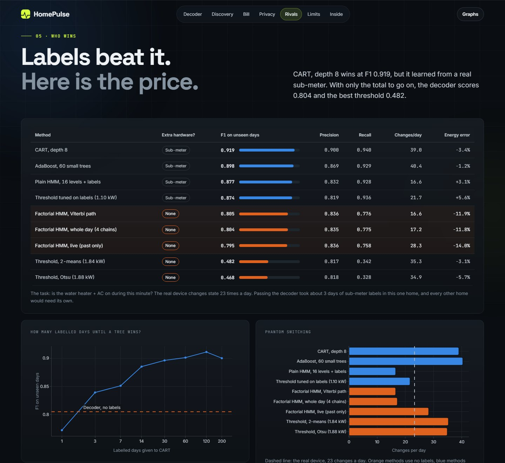

---

<a id="failed"></a>
## 🚧 What did not work

These were tested and are reported on purpose.

| Idea | What happened |
|---|---|
| **Separate every appliance** | Only one separates cleanly. Kitchen scores F1 0.38 and laundry 0.28, below a threshold tuned with labels (0.58 and 0.39). The smallest chains match no meter. |
| **Alarm for a quiet morning** | The original idea. Plain daily energy detected empty-home days better (AUC 0.98 against 0.96), and earlier spikes showed raw HMM likelihood does worse still. |
| **Wake-up time from the meter** | No useful link: r = 0.15, typical miss 2.2 hours. Dropped. |
| **Finding the fridge** | The smallest chain looked promising but only reaches F1 0.43 against the fridge-level signal. Not claimed. |
| **Kalman as a better alarm** | For a simulated 40% decline it alarms at 45 days, the same as a 7-day average, with false alarms around 40%. It earns its place by handling 82 missing days and giving honest uncertainty. |
| **HMM timing** | A chain assumes the same chance of switching off every minute, however long it has been on. Real runs do not behave that way. A semi-Markov model would fix this. |
| **Generalising** | This is one house, in France, from 2006 to 2010. Nothing here proves it works across homes or on Indian appliances. |

The privacy result carries a caveat as well: the decoded weekly rhythm matches the real kitchen and laundry rhythm at r = 0.69, but plain total power scores
r = 0.71. The leak is in the meter data itself, not in this model. Researchers have shown readings at 0.5-second resolution can even reveal
[which TV channel is on](https://www.nds.ruhr-uni-bochum.de/research/publications/SmartmeterContentIdent), and
[Japanese utilities already sell elder-care check-ins](https://www.ncbi.nlm.nih.gov/pmc/articles/PMC11175292/) built on 15 to 30 minute data.

---

<a id="screenshots"></a>
## 🖼️ Screenshots

| | |
|:---:|:---:|
| 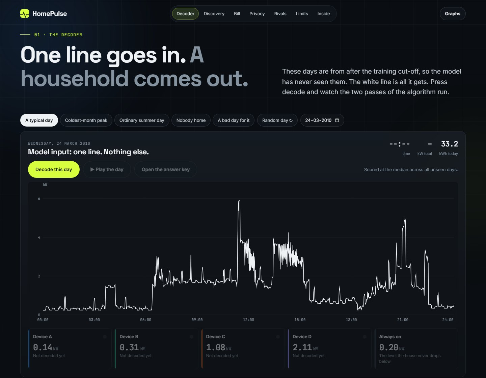<br>**The only input** | 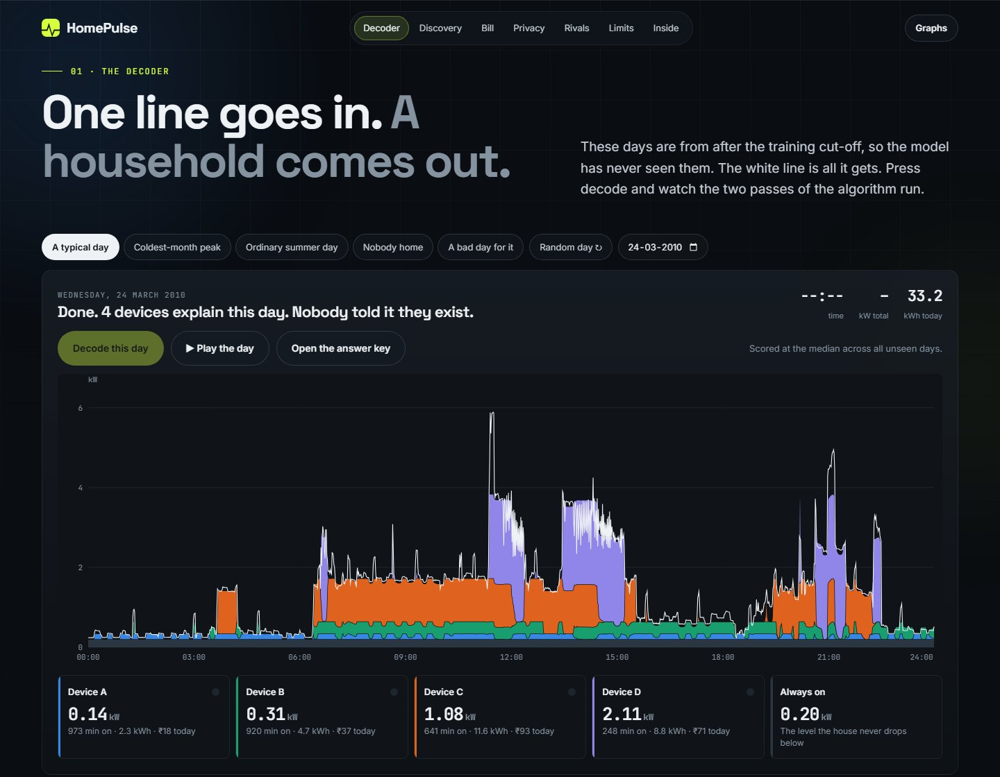<br>**After forward and backward passes** |
| 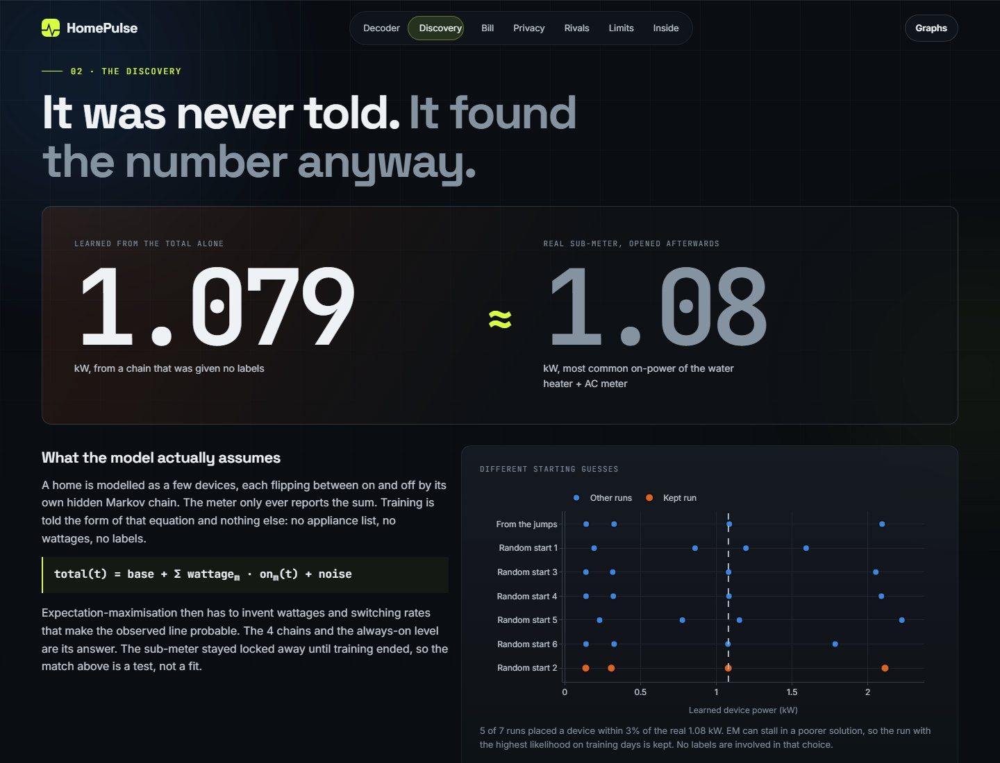<br>**The match, with restarts** | 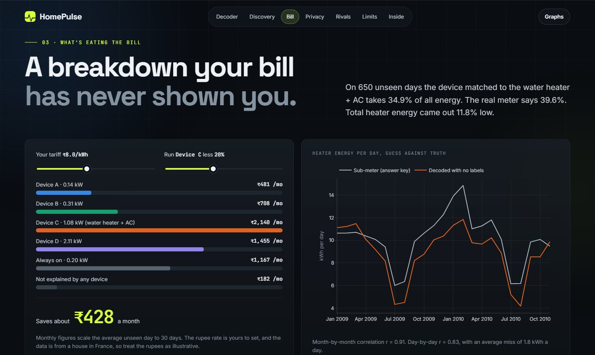<br>**The bill, by device** |
| 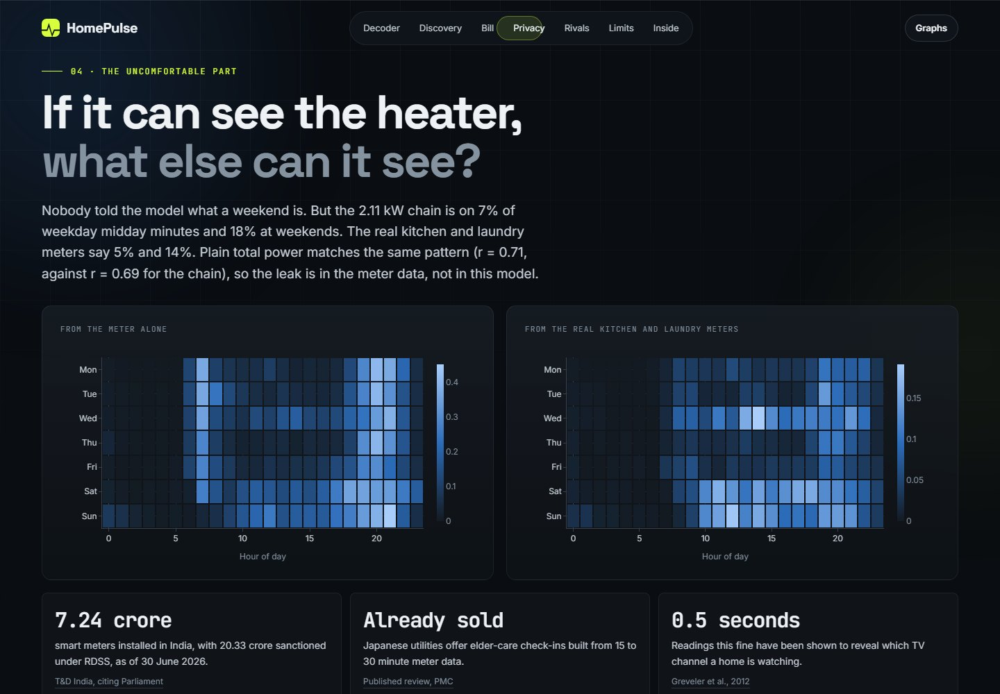<br>**What the meter gives away** | 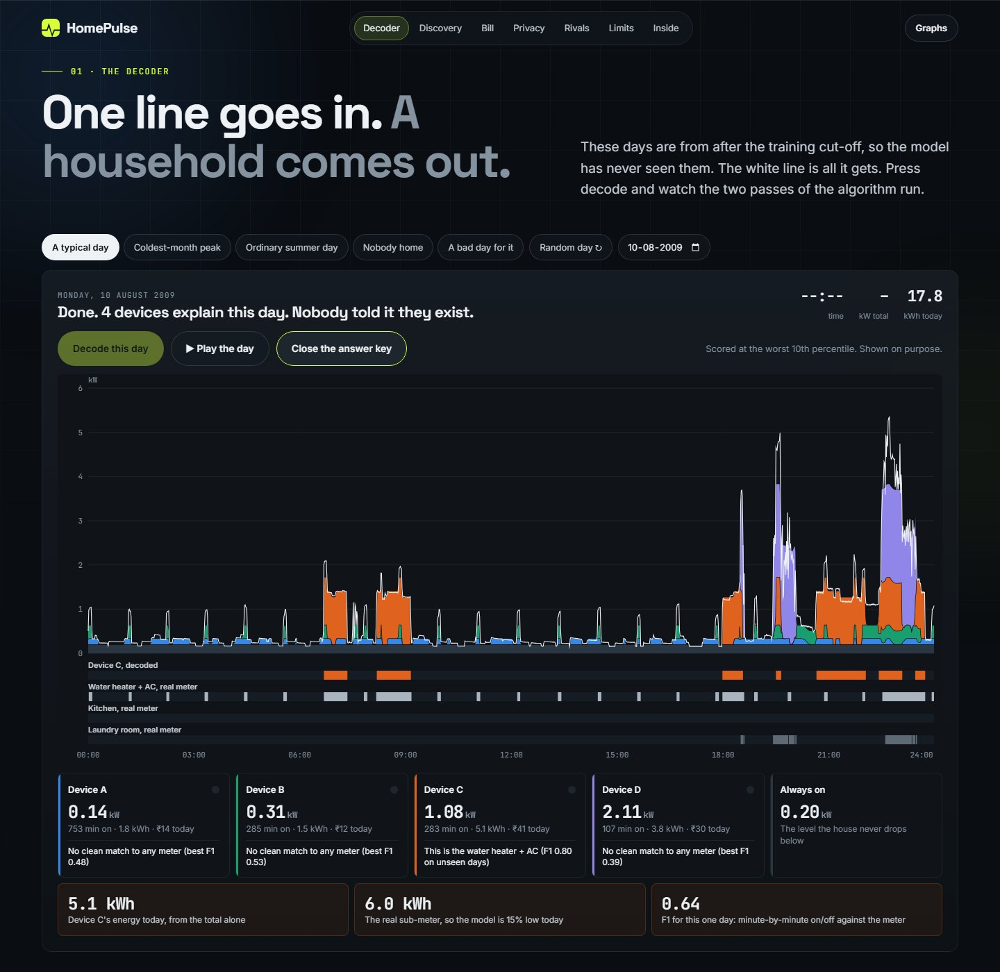<br>**A bad day, shown on purpose** |
| 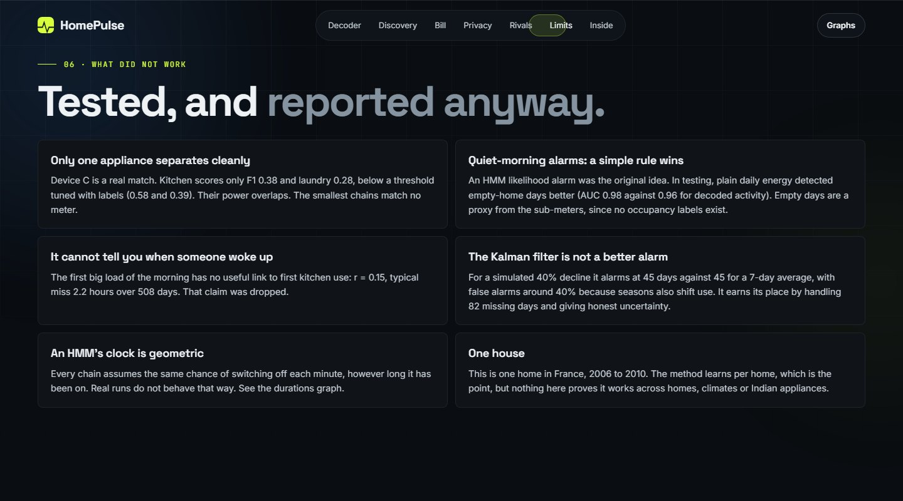<br>**What did not work** | 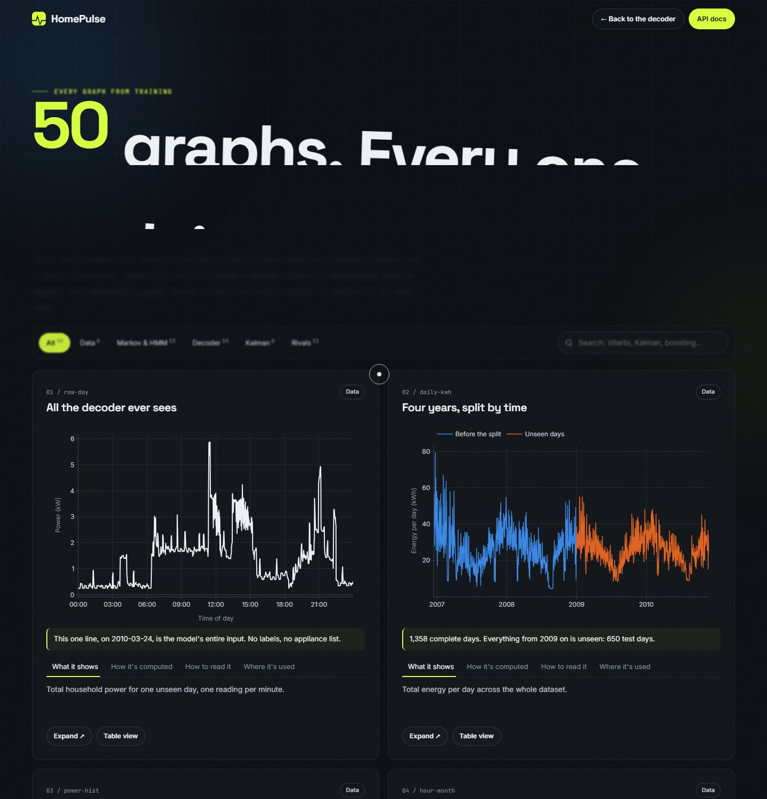<br>**50 training graphs, each explained** |

---

<a id="run"></a>
## ▶️ Run it

```bash
git clone https://github.com/krishkavin7512/HomePulse.git
cd HomePulse
python -m venv .venv
.venv/Scripts/activate        # on macOS or Linux: source .venv/bin/activate
pip install -r requirements.txt
python run.py                 # opens http://127.0.0.1:8004
```

Trained results are included, so it starts straight away. Useful extras:

```bash
python run.py --retrain       # retrain everything, about 5 minutes
python -m pytest tests -q     # 35 tests
```

The tests check forward-backward and Viterbi against brute-force enumeration of every path, sum-product against forward-backward, the Kalman filter against
batch Gaussian conditioning, EM's monotonic likelihood and its agreement from different starts, CART and AdaBoost against scikit-learn, and every API route.

```
backend/   markov  hmm  fhmm  sum_product  kalman  rivals  metrics  data  train  charts  api
frontend/  index.html  graphs.html  assets/
artifacts/ model.json  report.json  graphs.json
data/      days.npz
tests/     test_from_scratch.py  test_api.py
```

---

## 🗺️ Where it could go

- A hidden semi-Markov model, to fix the switching-time assumption
- A daily-routine clock in the transition matrix, since the plain model has no idea what time it is
- Validation across many homes, and on Indian tariffs and appliances
- Privacy-preserving reporting, such as adding noise to readings before they leave the meter

---

## 📄 Licence and credits

Code is under the [MIT License](LICENSE) © 2026 Kavin Krish. The dataset is by Georges Hebrail and Alice Berard, from the
[UCI Machine Learning Repository](https://archive.ics.uci.edu/dataset/235/individual+household+electric+power+consumption), under CC BY 4.0.
Monetary figures in the app use a tariff you set, and are illustrative.
